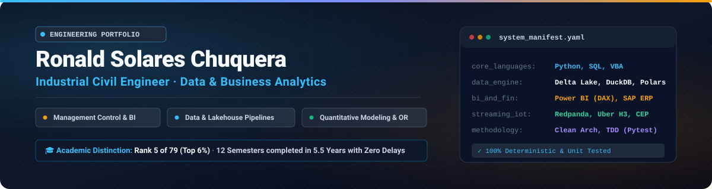

  

 

  
  
  
  

---

### Executive Profile

**Industrial Civil Engineer** (*Universidad de Tarapacá*) graduated **5th of 79 (Top 6%)**, completing the rigorous 12-semester formal curriculum in **5.5 years (11 semesters) with zero course failures or academic delays**. 

My core focus bridges **quantitative business acumen, operational modeling, and financial governance** with **production-grade data engineering and reproducible software practices** (Clean Architecture, Test-Driven Development with Pytest, Docker, and CI/CD).

* **Enterprise Experience (Inchcape PLC):** Engineered automated Python and VBA pipelines to extract and reconcile P&L statements (*Estados de Resultados*) from **SAP ERP**, diagnosed database migration feasibility toward relational SQL, and designed executive **Power BI (advanced DAX)** margin control dashboards.
* **Systems Mindset:** Every system below is built with isolated business logic, deterministic test suites, type annotations, and explicit edge-case handling.

---

### 🚀 Featured Engineering Systems

| System & Repository | Domain | Core Stack | Key Impact & Verified Metric |
| :--- | :--- | :--- | :--- |
| **[autonomous-software-factory](https://github.com/ronaldreighsrsc/autonomous-software-factory)** | AI Systems & Reliability | `Python 3.12` `Pydantic v2` `StateGraphs` `SQLite WAL` `Pytest` | Closed-loop software engineering engine. Deterministic Pytest oracle, SHA-256 anti-oscillation circuit breakers (<$0.25 USD, 8 steps), and time-travel debugging. **29 unit tests (100% pass rate)**. |
| **[cold-chain-telemetry-sentinel](https://github.com/ronaldreighsrsc/cold-chain-telemetry-sentinel)** | Real-Time IoT & Streaming | `Redpanda (Kafka)` `Uber H3` `DuckDB OLAP` `Python` | Complex Event Processing (CEP) under Newton's Law of Cooling. Evaluates thermal breach windows in **&lt;45 ms** to prevent **$120,000+ USD** in cargo loss. |
| **[delta-settlement-lakehouse](https://github.com/ronaldreighsrsc/delta-settlement-lakehouse)** | Fintech Lakehouse | `Delta Lake` `Polars` `DuckDB` `PyArrow` `Typer` | Cross-border B2B settlement engine on **Medallion ACID architecture**. In-flight data contracts (ISO 4217, SWIFT BIC) with automated Dead-Letter Queue (DLQ). |
| **[food-retail-demand-planner](https://github.com/ronaldreighsrsc/food-retail-demand-planner)** | Supply Chain & Retail Analytics | `Python` `SQL` `Streamlit` `OpenPyXL` | Multi-echelon demand planning across **+52 retail stores**. Hierarchical forecasting, WAPE/Bias mathematical auditing, safety stock, and FEFO perishable management. |
| **[retail-pricing-revenue-system](https://github.com/ronaldreighsrsc/retail-pricing-revenue-system)** | Econometrics & Pricing | `Python` `Statsmodels` `SQL` `Streamlit` | Omnichannel price elasticity ($\epsilon$) modeling via OLS HC1, Break-Even Lift validation, and automated inventory clearance engine for $DIO > 180$. |
| **[fraud-detection-system](https://github.com/ronaldreighsrsc/fraud-detection-system)** | ML & Financial Risk | `Python` `XGBoost` `Redis` `FastAPI` `Docker` | Real-time card transaction scoring under Chilean Ley 21.234. In-memory graph feature lookups in **&lt;2 ms** with synchronous latency SLA **&lt;30 ms**. |
| **[fundamental-analysis-hub](https://github.com/ronaldreighsrsc/fundamental-analysis-hub)** | Equity Research & Valuation | `Python` `SEC EDGAR API` `FRED API` `REST` | Automated 10-K/10-Q financial statement parser. Suite of 7 intrinsic value models (DCF, Reverse DCF, Graham 1974 with Fed AAA yield). **62 unit tests (100% pass rate)**. |
| **[edge-network-resilience-system](https://github.com/ronaldreighsrsc/edge-network-resilience-system)** | IoT Edge & Telemetry | `Python` `FastAPI` `Streamlit` `SQLite WAL` `MCDA` | Multi-criteria decision algorithm (TOPSIS with hysteresis) for industrial AP roaming. Lightweight daemon (&lt;120 MB RAM), DNS failover, and **49 unit tests (100% pass rate)**. |
| **[predictive-maintenance-system](https://github.com/ronaldreighsrsc/predictive-maintenance-system)** | Industrial ML & Reliability | `Python` `Scikit-learn` `Streamlit` `SAP PM` | Real-time telemetry monitoring (ISO 13374) for turbomachinery. Bayesian cost matrix cutting false alarms by **38%**, Weibull RUL estimation, and automated SAP PM work orders. |
| **[mlops-algorithmic-trading](https://github.com/ronaldreighsrsc/mlops-algorithmic-trading)** | Quantitative Trading & MLOps | `Python` `FastAPI` `Docker` `Pytest` | Event-driven order book streaming engine with **&lt;15 ms execution**. Fractional Kelly sizing, Risk Parity capital allocation, automated Kill-Switch, and **35 automated tests**. |

---

### 🛠️ Technical Toolbox

<table>
  <tr>
    <td width="25%"><strong>Data Engineering &amp; Lakehouse</strong></td>
    <td>
      <code>Python</code> · <code>SQL</code> · <code>Delta Lake</code> · <code>DuckDB</code> · <code>Polars</code> · <code>PyArrow</code> · <code>Redpanda (Kafka)</code> · <code>ETL/ELT Pipelines</code> · <code>Data Contracts</code>
    </td>
  </tr>
  <tr>
    <td width="25%"><strong>BI, Finance &amp; Operations</strong></td>
    <td>
      <code>Power BI (Advanced DAX)</code> · <code>SAP ERP</code> · <code>Financial Modeling (DCF / WACC)</code> · <code>Excel (Dynamic Modeling &amp; VBA)</code> · <code>Demand Planning (S&amp;OP / WAPE)</code> · <code>Lean Six Sigma</code>
    </td>
  </tr>
  <tr>
    <td width="25%"><strong>Machine Learning &amp; Modeling</strong></td>
    <td>
      <code>Scikit-learn</code> · <code>XGBoost</code> · <code>Statsmodels</code> · <code>TreeSHAP</code> · <code>Graph Theory (NetworkX)</code> · <code>MCDA (TOPSIS)</code> · <code>Uber H3 Spatial Indexing</code>
    </td>
  </tr>
  <tr>
    <td width="25%"><strong>Software &amp; Infrastructure</strong></td>
    <td>
      <code>Pydantic v2</code> · <code>StateGraphs / FSM</code> · <code>Git &amp; GitHub Actions</code> · <code>Docker</code> · <code>Linux / Bash</code> · <code>Test-Driven Development (Pytest)</code> · <code>FastAPI</code> · <code>Streamlit</code> · <code>Clean Architecture</code>
    </td>
  </tr>
</table>

---

### 📜 Accredited Certifications

* 🇬🇧 **Cambridge Assessment English:** B2 First (Upper-Intermediate, Overall Score: 172) — *January 2025*
* 🤖 **NVIDIA Deep Learning Institute (DLI):** Applications of AI for Anomaly Detection — *September 2025*
* 📈 **Six Sigma Academy Amsterdam (SSAA):** Certified Lean Six Sigma (Continuous Improvement & Process Excellence) — *December 2025*
* 📊 **Instituto Latinoamericano de Capacitación (ILCP):** Microsoft Power BI (DAX) & Advanced Dynamic Modeling in Excel — *2024*

---

### 🎯 Target Roles & Collaboration

I am actively targeting Entry-Level, Junior, and Trainee roles where rigorous quantitative analysis directly moves business KPIs:

* **Roles:** Data Analyst · Business Intelligence Analyst · Analytics Engineer · Management Control Analyst (*Control de Gestión*) · Trainee (Supply Chain, Finance, or Operations).
* **Location Preference:** Santiago, Chile (On-Site / Hybrid) or Worldwide (Remote).
* **Connect:** Feel free to reach out via [LinkedIn](https://www.linkedin.com/in/ronald-solares-chuquera-69232a150/) for technical discussions, code walk-throughs, or job opportunities.

 

  Built with precision and tested reproducibility · Ronald Solares Chuquera

